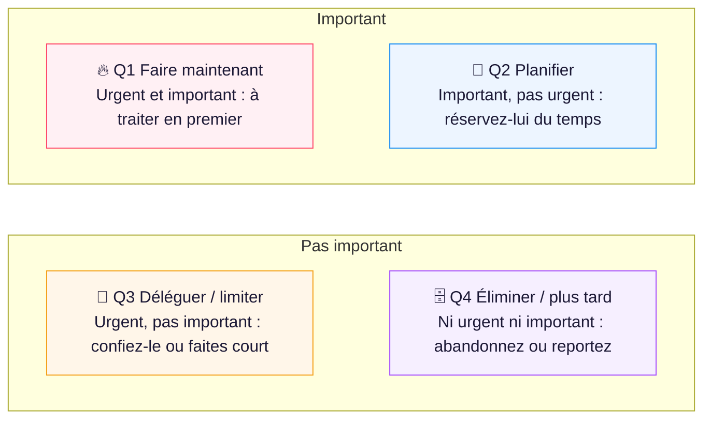
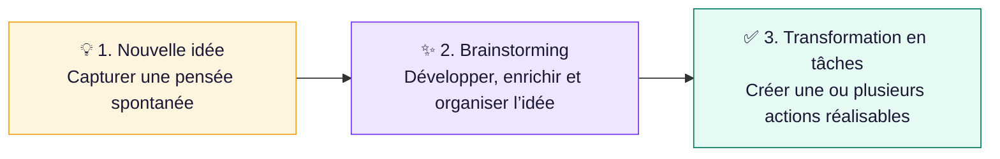

# FocusWithAkram — guide d’utilisation

Mis à jour le **6 novembre 2026** pour Angular et React (Mes achats et Notes & idées : Angular seulement ; « Mes achats » décrit la version simplifiée du lot 13, Notes & idées et la matrice leurs tutoriels des lots 14 et 15 ; onglets, barre d’outils collée, surlignage, liste d’émojis et export PDF de Notes & idées ajoutés le 10 novembre 2026). Installation : [exploitation](../technique/exploitation.md). Les interfaces utilisent les mêmes données ; leur présentation et leur mode d’enregistrement peuvent différer.

## 1. Ouvrir l’application

Après lancement, ouvrir Angular sur `http://127.0.0.1:4200` ou React sur `http://127.0.0.1:5173`. Il n’y a pas de compte à créer pour l’usage local actuel.

Sur ordinateur, la barre latérale permet de naviguer et de se replier. Sur mobile, la barre inférieure donne les accès principaux ; **Plus** ouvre les destinations complémentaires. Les pages communes sont Tableau de bord, Matrice d’Eisenhower, Mes tâches, Focus / Pomodoro, Calendrier, Statistiques, Projets, Archives et Paramètres ; Angular ajoute **Mes achats** et **Notes & idées**.

## 2. Première utilisation : préparer sa journée

1. Ouvrir **Paramètres** et choisir le fuseau, le thème et le premier jour de la semaine.
Au premier lancement, l’application demande votre **pseudo** ; le tableau de bord vous accueille ensuite par « Hello *pseudo* ». Il se modifie dans **Paramètres → Apparence et région**.
2. Créer quelques tâches avec **Nouvelle tâche**. Donner un titre concret et, si utile, un projet et une échéance.
3. Les répartir dans la matrice : Q1 faire maintenant, Q2 planifier, Q3 limiter/déléguer, Q4 plus tard/éliminer.
4. Choisir les trois priorités du jour depuis le tableau de bord.
5. Ouvrir **Focus / Pomodoro**, configurer le minuteur puis commencer une session.

Les paramètres et le classement sont conservés côté serveur. Une autre interface déjà ouverte peut nécessiter un rechargement pour afficher le même état.

## 3. Créer et modifier une tâche

Le titre est obligatoire. Le formulaire propose description, quadrant, projets, étiquettes, estimation et dates prévues. La **description** s’écrit avec l’éditeur des notes (barre d’outils, tableaux, alertes, schémas ASCII, aperçu ou mode Visuel) et s’affiche mise en forme dans le détail de la tâche ; l’ancien champ « Notes » a disparu (son contenu a rejoint la description). Une tâche peut faire partie de **plusieurs projets** : le champ **Projets** affiche les projets choisis en pastilles (le premier est le projet principal, × pour le retirer) et une **recherche** ouvre une liste filtrée (sans tenir compte des accents) ; Entrée choisit le premier résultat. Les sous-tâches ne sont plus proposées. Les étiquettes se saisissent en liste dans les formulaires ; les propositions existantes facilitent leur réutilisation.

Les dates affichées utilisent le fuseau configuré. Une date vide reste inconnue ; elle ne signifie pas minuit aujourd’hui. Une estimation est une durée attendue, distincte du temps travaillé par Pomodoro.

Ouvrir le détail d’une tâche pour consulter ses informations, sa description mise en forme, sa chronologie et ses cycles. Les menus d’actions permettent notamment modifier, dupliquer, terminer ou supprimer selon son état.

## 4. Utiliser la matrice et les listes

Sur grand écran, les quatre quadrants sont affichés en grille. Déplacer une carte dans un autre quadrant modifie son importance/urgence et enregistre son nouvel emplacement. Sur petit écran, sélectionner l’onglet Q1, Q2, Q3 ou Q4.

Pour le clavier, placer le focus sur la carte puis utiliser **Alt + 1…4** pour changer de quadrant et **Alt + ↑/↓** pour modifier l’ordre, lorsque cette carte expose les commandes de déplacement. La souris n’est pas obligatoire pour les parcours couverts.

### Tutoriel de la matrice

Le principe tient en deux questions : la tâche est-elle **urgente** ? est-elle **importante** ? La case où elle tombe dit quoi en faire :

Colonnes : **Urgent** à gauche, **Pas urgent** à droite ; lignes : **Important** en haut, **Pas important** en bas (Q1 en haut à gauche, comme sur la page).

- Le **tutoriel de la matrice** (Angular) s’ouvre seul à votre première visite. Il montre cette grille aux couleurs des quadrants (elle reste en 2 × 2 sur téléphone), puis : le bouton **Nouvelle tâche** (touche N), les onglets Q1 à Q4 (sur petit écran seulement), les quatre cases (couleur, nombre de tâches, retard, bouton **+** et ajout rapide), une carte de tâche (glisser-déposer, **Alt + 1…4**, **Alt + ↑/↓**, clic pour ouvrir, menu pour lancer un Pomodoro), le secret de la case **Planifier** (Q2 mise en avant : les tâches importantes mais pas urgentes sont celles qui vous font avancer ; planifiez-les avant qu’elles deviennent urgentes, Q1 se videra), les filtres (recherche, projet, statut, étiquette, **En retard**), enfin le bouton qui le relance. Une étape sans élément à montrer (aucune tâche, onglets sur grand écran) est sautée.
- **Suivant**, **Précédent**, **Passer** (Échap passe aussi). Une fois terminé ou passé, il ne revient plus de lui-même, indépendamment de celui de Notes & idées ; le bouton **Comment ça marche ?** en haut de la matrice, à côté de **Nouvelle tâche**, le relance. Quitter la page pendant le tutoriel l’interrompt sans rien enregistrer.

Dans **Mes tâches**, choisir Priorités, Aujourd’hui, Semaine, Toutes, En retard ou Terminées. Les filtres projet, statut, texte et étiquette dépendent de la page. Si une tâche semble absente, commencer par retirer les filtres. Pour retrouver des tâches terminées anciennes, préférer **Archives**.

## 5. Commencer, terminer et restaurer

- **Commencer** renseigne le début réel, puis place la tâche en cours. La pause/remise à faire ne supprime pas ce début.
- **Terminer** renseigne la fin réelle et archive la tâche. Si elle n’a jamais commencé, indiquer son début réel ; l’application ne l’invente pas.
- **Restaurer**, depuis les archives, rouvre la tâche dans un nouveau cycle. Les dates réelles courantes sont réinitialisées et l’ancien historique reste disponible.

Une fin antérieure au début ou une date réelle future incohérente est refusée. Corriger la valeur indiquée dans le message, puis enregistrer de nouveau. En cas de modification concurrente, recharger le détail avant de recommencer.

## 6. Configurer le Pomodoro dans Focus

Ouvrir **Focus / Pomodoro → Configurer**. Le panneau **Minuteur Pomodoro** contient :

| Option                      | Usage                                                                      |
| --------------------------- | -------------------------------------------------------------------------- |
| Travail                     | Durée d’une séance de concentration : 1 à 180 minutes                      |
| Pause courte / longue       | Récupération courte de 1 à 60 min ; longue de 1 à 120 min                  |
| Sessions avant pause longue | Nombre de séances du cycle : 1 à 12                                        |
| Objectif quotidien          | Cible de concentration : 0 à 720 minutes                                   |
| Démarrage des pauses        | Enchaîner automatiquement vers la pause quand les conditions le permettent |
| Session suivante            | Reprendre automatiquement le travail selon le réglage                      |
| Son                         | Activer/désactiver et choisir cloche, carillon ou son doux                 |
| Notifications               | Demander l’autorisation du navigateur et activer les notifications         |

**Angular enregistre automatiquement** au changement d’un champ. **React demande de cliquer sur Enregistrer le minuteur** ; une saisie non enregistrée reste un brouillon. Attendre la confirmation ou la disparition de l’état occupé avant de quitter le formulaire.

Les réglages Pomodoro ne sont plus dans les paramètres généraux. Une session déjà démarrée garde sa durée ; modifier le travail à 40 minutes ne rallonge pas une séance en cours. Angular propose aussi un bouton d’écoute du son ; ne pas supposer sa présence identique dans React.

Si les notifications sont refusées, vérifier l’autorisation du site dans le navigateur puis réactiver l’option. Un navigateur ne prenant pas en charge cette fonction ne pourra pas l’activer. L’application n’est pas un réveil garanti lorsque le navigateur est fermé.

## 7. Travailler avec le minuteur

1. Choisir Concentration, Pause courte ou Pause longue.
2. Associer une tâche si le travail doit l’alimenter.
3. Appuyer sur **Démarrer**.
4. Utiliser **Pause**, **Reprendre**, la fin ou l’interruption selon le besoin. Les commandes visibles dépendent de l’état de la session.
5. Consulter le temps travaillé et l’historique sous le minuteur.

Une seule session peut être active pour le backend partagé. Si Angular a déjà démarré une séance, React ne peut pas en créer une seconde indépendante. Reprendre l’existante ou l’interrompre.

Recharger la page ne remet pas le compteur à zéro : le navigateur resynchronise la séance avec le serveur. Un décalage temporaire peut se corriger au retour au premier plan. En cas de réseau coupé, attendre la resynchronisation avant d’interpréter l’état comme définitivement enregistré.

## 8. Calendrier et projets

Le calendrier propose Mois, Semaine et Jour, la navigation temporelle et les tâches non planifiées. Sélectionner une date pour voir ses tâches. Le déplacement vers une autre date enregistre la replanification ; vérifier les horaires dans le détail si le fuseau a changé.

Dans **Projets**, le bouton **Nouveau** propose **Dossier** (un groupe de projets) ou **Projet** (nom, description, dossier et couleur). La progression dépend des tâches réellement associées. Ouvrir l’aperçu d’une tâche pour accéder à son détail. Rendre un projet **inactif** (menu **⋯** de sa carte) et le supprimer sont deux opérations différentes ; une suppression conserve les tâches en les détachant du projet. **Projets actifs / Projets inactifs**, au-dessus de la liste, choisit la vue : les projets inactifs restent rangés dans leurs dossiers et se réactivent par **Réactiver**.

**Dossiers de projets** (Angular). **Nouveau → Dossier** crée un dossier (nom et couleur, par exemple « DMP » pour 20 applications, « MES » pour 17 autres). Un projet se range dans un dossier depuis sa fenêtre (**Dossier**), depuis le menu **⋯** de sa carte (**Déplacer vers…**, **Sortir du dossier**) ou en le créant avec **+ Projet** dans l’en-tête du dossier. La barre des dossiers filtre la page (Tous, un dossier, Sans dossier) ; dans « Tous », les dossiers sont **fermés par défaut**, y compris un dossier tout juste créé : un clic sur son nom l’ouvre (choix mémorisé dans le navigateur). Une recherche ou le choix d’un dossier dans la barre montre directement ses projets. Le dossier sert seulement au rangement : **une tâche reste liée à ses projets**, jamais à un dossier, et filtres, progression et statistiques ne changent pas. Supprimer un dossier conserve ses projets et leurs tâches, sans dossier.

**Exporter et importer des projets** (Angular). Le bouton **Importer / Exporter** propose deux choix.

- **Exporter…** ouvre une fenêtre à trois options : tous les dossiers et projets avec leurs tâches ; les dossiers et projets seulement (sans les tâches) ; ou **certains dossiers** avec leurs projets. Pour ce dernier choix, la liste des dossiers s’affiche sous l’option : cocher un dossier, plusieurs ou tous (**Tout sélectionner** / **Tout désélectionner**, compteur « 2 sur 5 sélectionné(s) »), ainsi que « Projets sans dossier », puis décider d’**inclure ou non les tâches**. Une phrase en bas de la fenêtre résume le contenu du fichier ; **Exporter** reste grisé tant qu’aucun dossier contenant des projets n’est coché. Sur un petit écran, seule la zone des choix défile : les boutons restent visibles. Le menu **⋯** d’un dossier ou d’un projet exporte aussi celui-ci seul. Le fichier `.json` contient les dossiers, les projets, leurs tâches (y compris celles partagées avec d’autres projets) et leurs sessions Pomodoro terminées.
- **Importer un fichier…** vérifie d’abord le fichier sans rien modifier et affiche **ce qui va se passer** (dossiers, projets et tâches créés, remplacés ou ignorés). Si un dossier du fichier existe déjà dans l’application, ou si certains de ses projets existent déjà (même nom, majuscules comprises), un **avertissement** liste ces dossiers et l’emplacement actuel des projets concernés, et propose :
  - **Ignorer ces dossiers** (choix par défaut) : ils restent exactement comme ils sont ; leurs projets et tâches du fichier ne sont pas importés, tout le reste du fichier l’est ;
  - **Remplacer par le fichier** : le fichier écrase l’existant pour ces dossiers (couleur du dossier ; description, couleur, état actif/inactif et dossier des projets ; tâches déjà présentes remplacées par celles du fichier, en gardant leurs sessions Pomodoro et le Top 3). Rien n’est supprimé : ce qui n’est pas dans le fichier reste en place.

  L’aperçu se met à jour selon le choix ; rien n’est importé avant **Importer**. Réimporter un fichier sans conflit ne crée pas de doublons. L’import de projets ne touche jamais aux préférences, au Top 3, à « Mes achats » ni aux idées, même si l’on choisit une sauvegarde complète.

## 9. Tableau de bord, statistiques et archives

Le dashboard aide à choisir la prochaine action : tâches restantes, réalisées, retard, objectif, Top 3, mini-matrice et session. Les statistiques permettent de changer la période et de comparer le temps planifié, réel écoulé et actif.

Ces temps peuvent être différents sans erreur : une tâche commencée lundi et finie mercredi a une durée écoulée longue, même si elle ne représente que trois séances de travail. Les pauses et interruptions de sessions sont distinguées.

En tête des archives, **Anciennes idées** liste les idées transformées en tâche, archivées ou supprimées (avec le temps restant avant suppression définitive), avec recherche et bouton **Restaurer**. Les archives regroupent ensuite les tâches par fin réelle dans le fuseau de l’utilisateur. Consulter le détail pour retrouver les dates et sessions du cycle ; restaurer pour recommencer sans effacer l’ancien travail.

## 10. Exporter et importer

Dans **Paramètres**, exporter les tâches en CSV ou JSON, ou télécharger une **Sauvegarde complète**. Pour une reprise complète des données métier, préférer cette dernière au CSV : elle contient aussi les dossiers de projets, les préférences, le Top 3, « Mes achats » et les **notes et idées** (catégories, idées et lien entre chaque tâche et son idée d’origine). À l’import, l’aperçu indique ce qui sera créé, ignoré (doublons) ou signalé comme invalide ; les préférences du fichier remplacent les préférences courantes.

Pour importer : sélectionner le JSON, lire l’aperçu des créations, réutilisations, doublons et erreurs, puis confirmer l’import. Conserver le fichier d’origine jusqu’à vérification des tâches, projets et historiques.

Depuis le format v2, la sauvegarde complète contient les préférences (thème, fuseau, minuteur, mode d’éditeur des notes) ; l’export CSV ne les contient pas. Un export contient des données personnelles en clair : le conserver à un endroit adapté.

## 11. Mes achats : votre mois, pas à pas

Le module **Mes achats** (menu, ou G puis B ; Angular) suit votre argent réel, mois par mois. Règles complètes : [spécification](mes-achats/specification.md) et [feuille du mois](mes-achats/feuille-du-mois.md).

En bref : **un seul compte** pour tout votre argent, une **feuille par mois** (prévu, réel, écart), et votre **épargne = ce qui reste** à la fin du mois.

### 11.1 Premier accès : votre argent aujourd’hui

1. Ouvrez **Mes achats** et commencez : la fenêtre **Mon argent aujourd’hui** demande votre total.
2. Additionnez tout votre argent : compte en banque, épargne (livret…) et espèces. Saisissez ce **total** (virgule acceptée), gardez ou changez le nom du compte, puis **Commencer**.
3. C’est le point de départ de tous les calculs. Il n’y a qu’un compte : vous n’en ajouterez pas d’autre.

À la première visite, une **visite guidée** présente les écrans (§ 11.9).

### 11.2 Lire « Mon mois »

**Mon mois** est l’onglet par défaut. Choisissez le mois en haut de la feuille ; le résumé reprend les totaux. Chaque ligne montre le **prévu**, le **réel** (ce qui a vraiment été reçu ou payé) et l’**écart** (réel − prévu).

| Section | Vous y voyez | Vous y faites |
| --- | --- | --- |
| Revenus | Salaire et autres revenus prévus du mois | Confirmer le montant reçu (§ 11.3) |
| Dépenses fixes | Loyer, téléphone, transport… déjà remplis | Confirmer « payé » (§ 11.4) |
| Dépenses variables | Courses, restaurants… : plafond, dépensé, reste | Ajouter les dépenses ou le total du mois ; commenter un dépassement (§ 11.5) |
| Autres dépenses | Imprévus, achats réalisés | Bouton **Dépense** ou touche **E** (§ 11.6) |
| En bas | Épargne prévue, épargne réelle, objectif | Vérifier que l’objectif est atteint (§ 11.8) |

Seul le **réel** change votre solde ; le prévu sert à anticiper.

### 11.3 Votre salaire : une saisie pour plusieurs mois

1. Ajoutez un **revenu prévu** (section **Revenus** de Mon mois, ou **Opérations → Revenus et charges récurrents → Revenu prévu**).
2. Indiquez le montant, le jour de versement et la période : un seul mois, ou plusieurs (ex. 2 290 € le 28, de novembre 2026 à février 2027).
3. Le revenu apparaît **prévu** dans chaque mois de la période. Le jour venu, confirmez le montant **réellement reçu** : il peut être plus bas (absence, prime en moins). Le prévu reste affiché avec l’écart ; les autres mois ne changent pas.
4. Erreur de saisie ? Confirmez de nouveau avec le bon montant, ou annulez l’enregistrement : la ligne redevient prévue.

Un revenu ponctuel (cadeau, vente) se saisit dans **Opérations → + Opération**, type Revenu.

### 11.4 Dépenses fixes : une fois pour toutes

1. Déclarez une fois chaque charge fixe (loyer, téléphone, abonnement de transport) : **Opérations → Revenus et charges récurrents → Charge ou abonnement** (montant, jour, catégorie).
2. Chaque mois, la feuille en est **déjà remplie**. Quand c’est payé, confirmez **payé** avec le montant réel.
3. Le montant change ? Deux choix :
   - **À partir de ce mois** : le loyer passe de 350 € à 400 € en janvier 2027 → choisissez janvier 2027 et 400 € ; novembre et décembre 2026 restent à 350 €.
   - **Ce mois seulement** : une facture exceptionnellement plus élevée → seul ce mois change.
4. Pas de paiement ce mois-ci : **sautez** l’échéance. Fin d’un abonnement : résiliez-le dans **Revenus et charges récurrents** ; l’historique reste.

### 11.5 Dépenses variables : un plafond par poste

1. Dans la section **Dépenses variables** de Mon mois, créez une **dépense variable plafonnée** : une catégorie et un plafond mensuel (ex. courses 300 €), à partir d’un mois.
2. Au fil du mois, chaque dépense de cette catégorie (bouton **Dépense**, touche **E**) s’ajoute au **dépensé** ; la feuille affiche le **reste**.
3. Vous ne gardez pas chaque ticket ? **Saisir le total du mois** : indiquez ce que vous avez dépensé en tout ; l’application complète les dépenses déjà saisies. Impossible pour un mois futur ou pour un total plus bas que ce qui est déjà saisi.
4. **Dépassement** : la dépense n’est jamais bloquée, mais la ligne le signale et la feuille vous demande un **commentaire** (« invités pour un anniversaire »). Il reste attaché à ce mois.
5. Changer un plafond : **à partir d’un mois**, comme pour une dépense fixe. Ne plus plafonner un poste : terminez-le après un mois ; ses dépenses restent dans l’historique.

La somme de ces plafonds forme le **plafond variable** du mois. Un achat d’un projet d’achat (§ 11.10) ne l’entame pas.

### 11.6 Autres dépenses et saisie rapide

- Touche **E** (ou bouton **Dépense**, ou la palette) depuis n’importe quel écran : montant (virgule acceptée), libellé, catégorie. Cochez « Indispensable » pour une charge, « Exceptionnelle » pour un imprévu.
- Une dépense d’une catégorie plafonnée rejoint sa ligne ; les autres apparaissent dans **Autres dépenses**.
- **Retour d’un produit** : dans **Opérations**, menu **⋯ → Saisir un remboursement** sur la dépense ; il réduit les dépenses de la catégorie, ce n’est pas un revenu.
- **Doublon** : si une opération semblable existe (même montant, à trois jours près), l’application le signale ; confirmez si ce n’est pas la même.
- **Annuler** garde l’opération dans l’historique sans effet ; **Supprimer** l’efface (erreur de saisie).

### 11.7 Prêts : une simple catégorie

| Vous… | Saisissez |
| --- | --- |
| prêtez de l’argent | une dépense, catégorie « Prêts » |
| remboursez quelqu’un | une dépense, catégorie « Prêts » |
| empruntez de l’argent | un revenu, catégorie « Prêts » |
| êtes remboursé | un revenu, catégorie « Prêts » |

La catégorie d’un revenu est facultative : choisissez « Prêts » dans le formulaire du revenu. Si elle n’existe pas encore, créez-la dans **⚙ Réglages → Catégories**. Il n’y a plus de suivi du reste dû ni d’alerte de retard.

### 11.8 Épargne et objectif

- L’épargne n’est pas un compte : c’est **ce qui reste** du mois. **Épargne prévue** = revenus prévus − dépenses prévues ; **épargne réelle** = revenus reçus − dépenses payées.
- Fixez votre **objectif d’épargne** dans **⚙ Réglages → Préférences financières** (objectif par défaut, repris chaque mois), ou pour un mois précis avec le bouton **Objectif d’épargne** de **Mon mois**. En bas de la feuille, l’épargne réelle est comparée à cet objectif.
- **Analyses** montre, mois par mois, l’épargne, l’objectif **atteint** ou **manqué** et le plafond variable **tenu** ou **dépassé**.
- Rien à « virer » vers l’épargne : l’argent qui reste sur le compte est votre épargne.

### 11.9 Visite guidée et bulles d’aide

- La **visite guidée** s’ouvre seule à votre première visite de Mes achats. Chaque étape a **Suivant**, **Précédent** et **Passer**. Une fois terminée ou passée, elle ne revient plus d’elle-même ; le bouton **?** en haut de Mes achats la relance.
- Les petites icônes **?** à côté des sections et des notions (prévu, réel, plafond, épargne, « à partir de », « ce mois seulement ») ouvrent une courte explication. Elles s’utilisent aussi au clavier et sont lues par les lecteurs d’écran.

### 11.10 Où trouver le reste

| Onglet | Contenu |
| --- | --- |
| **Opérations** | **Historique** filtrable (période, type, statut, catégorie, nature, montant, texte) et bouton **+ Opération** (revenu ponctuel, dépense prévue). Vue **Revenus et charges récurrents** : salaire, loyer, abonnements, paiements en plusieurs fois ; suspendre, reprendre, résilier. |
| **Projets d’achat** | Ajoutez un produit ou un service (prix estimé, maximum acceptable, date cible, importance, urgence) : l’application dit s’il est **réalisable** à la date voulue (revenus et échéances prévus, plafond variable, épargne du mois, réserve de sécurité, autres achats prioritaires, trois mois suivant l’achat) et propose sinon une date réaliste, un budget réduit, un effort d’épargne ou une priorité plus haute. Vue **Matrice** (glisser ou **⋯ → Déplacer en Qx**), **Réserver de l’argent**, **Je l’ai acheté**, **Reporter**, **Abandonner**, prévision de trésorerie et panneau **Et si… ?** (baisse de salaire, achat supplémentaire, report : rien n’est enregistré). |
| **Analyses** | **Statistiques** sur 3, 6, 12 ou 24 mois : revenus, dépenses, épargne, objectif et plafond mois par mois, dépenses par catégorie, plus grosses dépenses, écart entre prix estimés et payés. **Calendrier** : le mois jour par jour, opérations réalisées et prévues. |
| **⚙ Réglages** | **Mon compte** : **Renommer**, **Corriger le solde** (l’écart avec la banque devient une correction datée et visible). **Préférences financières** : réserve de sécurité, plafond variable et objectif d’épargne par défaut, seuil d’alerte (80 % par défaut). **Catégories** : créer, renommer, déplacer, archiver (une catégorie utilisée s’archive au lieu d’être supprimée). |

Les **alertes** signalent ce qui demande votre attention : plafond presque atteint ou dépassé, dépense variable au-delà de son plafond, salaire non reçu, échéances des 7 prochains jours ou en retard, disponible prévu sous votre réserve, projet d’achat devenu risqué. Chacune mène à l’onglet où agir et disparaît d’elle-même quand sa cause disparaît.

### 11.11 Après la mise à jour du 5 novembre 2026

Si vous utilisiez déjà Mes achats :

- vos comptes ont été **fusionnés** en un seul, sans changer le total : le solde de départ de chaque autre compte apparaît comme une correction « Solde de départ — <nom du compte> », et les virements entre vos comptes ont disparu ;
- vos **prêts** sont devenus des dépenses ou des revenus de la catégorie « Prêts » ;
- l’onglet Prêts, l’onglet Budget et la vue d’ensemble sont remplacés par **Mon mois** ; les anciens liens y mènent automatiquement (l’échéancier mène à **Opérations → Revenus et charges récurrents**, les statistiques et le calendrier à **Analyses**) ;
- votre disponible inclut désormais l’argent qui était sur un compte d’épargne.

## 12. Notes & idées : de l’idée à la tâche

La page **Notes & idées** (menu, ou G puis N) garde vos idées personnelles, professionnelles ou techniques pour les développer à votre rythme, puis les transformer en tâches. Une idée **n’a pas de statut** : ce sont les tâches qui en sont issues qui en ont un. Règles : [cahier des charges § 4.5](cahier-des-charges.md).

### 12.1 Le parcours d’une idée et le tutoriel

Chaque idée suit le même chemin, en trois étapes :

- Le **tutoriel « de l’idée à l’action »** s’ouvre seul à votre première visite de la liste des idées. Il commence par ce schéma (ambre, violet, vert ; de haut en bas sur téléphone), puis montre où se fait chaque étape : la barre de saisie rapide (**Nouvelle idée**), la liste des idées (**Brainstorming**), le bouton **Catégories**, le schéma de nouveau avec l’étape 3 mise en avant (**Créer une tâche** dans une idée), les vues **À transformer**, **Avec tâches** et **Favorites**, enfin le bouton qui le relance.
- Chaque étape a **Suivant**, **Précédent** et **Passer** (Échap passe aussi). Une fois terminé ou passé, il ne revient plus de lui-même (le choix est enregistré dans vos préférences) ; le bouton **Comment ça marche ?** en haut de Notes & idées le relance à tout moment. Quitter la page pendant le tutoriel l’interrompt sans rien enregistrer : il sera proposé de nouveau à la prochaine visite.

### 12.2 Pas à pas

1. **Noter une idée** : tapez un titre dans le champ en haut de la page puis **Entrée** (ou **Développer** pour l’ouvrir aussitôt). Depuis n’importe quelle page, la touche **I** (ou la palette : « Noter une idée ») ouvre une saisie rapide : un titre suffit.
2. **Développer** : cliquez sur une carte pour ouvrir l’éditeur ; l’idée s’ouvre aussi dans un **onglet** (§ 12.3). Titre, catégorie, étiquettes et contenu sont **enregistrés automatiquement** (« Enregistré » s’affiche en haut) ; quitter la page enregistre aussi la saisie en cours. Un titre vide n’est pas enregistré.
3. **Deux modes d’édition**, au choix avec le bouton **Markdown / Visuel** de l’éditeur (ou dans **Paramètres → Notes & idées**) :
   - **Markdown** : vous écrivez la syntaxe (`## Titre`, `- liste`, `- [ ] case à cocher`, `**gras**`) ; la barre d’outils l’insère pour vous, **Ctrl+B** / **Ctrl+I** mettent en gras / en italique, **Ctrl+Z** annule. L’onglet **Aperçu** montre le rendu ; on peut y cocher les cases.
   - **Visuel** : la mise en forme s’affiche directement pendant la saisie.

   Le contenu est le même dans les deux modes : une note écrite dans l’un s’ouvre dans l’autre. Le mode visuel peut réécrire légèrement la syntaxe (par exemple ajouter une ligne vide sous un titre) sans changer le contenu.

   **La barre d’outils reste à portée de main** : quand vous descendez dans un long texte, elle reste collée en haut de l’écran, sous la barre de recherche, jusqu’à la fin de l’éditeur. Le curseur ne passe jamais dessous : en remontant avec les flèches, la page défile pour le garder visible. Sur téléphone, elle tient sur une seule ligne, qui défile horizontalement.

   **Émojis** : le bouton 🙂 de la barre d’outils ouvre la liste des émojis, rangés par catégorie (Visages, Gestes et personnes, Cœurs et symboles, Travail et objets, Nature et météo, Nourriture, Activités et voyages, Drapeaux). Tapez un mot en français pour chercher (« fusée », « coche », « coeur », accents facultatifs), puis **Entrée** pour le premier résultat, ou cliquez sur un émoji : il s’insère à la position du curseur (ou remplace le texte sélectionné), en mode Visuel comme en Markdown. Les **Récents** (les 16 derniers choisis, retenus par le navigateur) s’affichent en premier. Au clavier : flèche bas depuis la recherche, flèches dans la grille, **Échap** pour fermer.

   **Schémas ASCII** : **Insérer → Schémas ASCII** ouvre l’atelier sur l’un de ses trois onglets ; le schéma est rangé dans la note comme un bloc de code `ascii`, lisible partout (GitHub, Obsidian, export).
   - **Arborescence de dossiers** : trois vues qui se suivent dans les deux sens. Le **texte** (style `tree`, traits `├──` ou ASCII `|--`, commentaires `# …` alignés ; une liste à puces ou indentée se colle aussi) ; la **hiérarchie** des dossiers et fichiers (renommer, l’icône bascule dossier ↔ fichier, ajouter un fichier ou un dossier dedans, monter, descendre, changer de niveau, supprimer ; au clavier **Entrée** ajoute un élément, **Tab** / **Maj+Tab** change de niveau, **Alt+↑** / **Alt+↓** déplace ; un nom terminé par « / » est un dossier) ; les **commandes** qui créent ces dossiers et fichiers, en **Bash** (`mkdir -p`, `touch`) ou **PowerShell** (`New-Item`, sans jamais écraser un fichier existant). Collez vos propres commandes (`mkdir`, `touch`, `New-Item`, `cd`, accolades `src/{app,lib}`, `echo > fichier`) : l’arborescence est reconstruite, les autres lignes sont signalées et ignorées.
   - **Tableau ASCII** : une grille (ajouter ou supprimer lignes et colonnes, alignement à gauche, au centre ou à droite, ligne d’en-tête, trait entre les lignes) et le texte encadré, synchronisés ; quatre styles (`+---+`, `┌───┐`, `╭───╮`, `╔═══╗`). Un tableau Markdown ou des cellules copiées d’un tableur se collent dans le texte.
   - **Bannière** : un texte en gros caractères (`█`, `#` ou ses propres lettres ; accents retirés) ou encadré.

   Pour modifier un schéma : bouton **Modifier** de son bloc en mode Visuel, ou **Insérer → Modifier ce schéma** avec le curseur dedans (les deux modes) ; **Ctrl+Z** annule la mise à jour. Dans le PDF, les traits Unicode deviennent `|`, `-`, `+` et `#`, colonnes conservées.

   **Surligner** : sélectionnez le texte, puis cliquez sur le bouton **Surligner** (le surligneur, souligné de la couleur en cours) ou appuyez sur **Ctrl+Maj+H**. La flèche à côté ouvre les quatre couleurs, **Jaune**, **Rouge**, **Bleu ciel** et **Violet**, ainsi que **Retirer le surlignage**. Une couleur choisie dans ce menu devient celle du bouton et du raccourci (retenue par le navigateur). Un second clic sur le bouton retire le surlignage de cette couleur ; une autre couleur le remplace. Dans le menu, la couleur du passage sous le curseur est cochée. En Markdown, le jaune s’écrit `==texte==` (que vous pouvez aussi taper en mode Visuel) et les autres couleurs `<mark data-color="red">texte</mark>` (`red`, `sky`, `violet`) ; un fichier exporté en .md reste surligné dans GitHub ou Obsidian, en jaune.
4. **Organiser** : une **catégorie** (créée dans l’écran **Catégories**, avec une couleur), des **étiquettes** séparées par des virgules et l’étoile **Favori**. La recherche porte sur le titre, le contenu **et les étiquettes** (taper le nom d’une étiquette suffit à retrouver l’idée ; le filtre déroulant des étiquettes a été retiré). La liste se filtre aussi par catégorie et par vue : **Toutes**, **Favorites**, **À transformer**, **Archivées** ; elle se trie par date de modification, de création ou par titre.
5. **Transformer en tâche** : dans l’éditeur, **Créer une tâche** ouvre le formulaire de tâche habituel, prérempli avec le titre et les étiquettes de l’idée ; **Reprendre le contenu de l’idée** copie le texte dans la description. Choisissez le quadrant (urgence et importance), une échéance si besoin, puis **Créer la tâche** : elle rejoint la matrice d’Eisenhower. L’idée quitte alors la liste : elle vit désormais comme tâche et reste consultable dans **Archives → Anciennes idées** (ou la vue **Archivées**), d’où **Restaurer** la ramène. Elle peut encore donner d’autres tâches depuis son éditeur.
6. **Suivre** : le panneau **Tâches issues de cette idée** liste ces tâches avec leur statut et leur quadrant ; cliquez pour ouvrir leur détail. Depuis le détail d’une tâche, le lien **Issue de l’idée « … »** ramène à l’idée. Dans **Mes tâches**, une pastille **Idée** signale ces tâches.
7. **Doublon** : si une tâche du même titre est déjà issue de cette idée, le formulaire le signale ; modifiez le titre ou confirmez avec **Créer quand même**.
8. **Supprimer ou archiver** : la corbeille propose deux choix. **Archiver** range l’idée dans les Archives. **Supprimer** efface aussitôt une idée sans tâche ; si des tâches en sont issues, l’idée reste **72 heures** dans les Archives (« Annuler la suppression » possible), puis elle est supprimée définitivement ; ses tâches restent, sans lien vers elle.

Supprimer une catégorie conserve ses idées, sans catégorie.

### 12.3 Onglets des idées ouvertes

Chaque idée ouverte prend un **onglet** dans la barre en haut de Notes & idées, comme dans un navigateur : on passe d’une idée à l’autre sans repasser par la liste.

- **Ouvrir** une idée (carte de la liste, **Développer**, saisie rapide, lien **Issue de l’idée « … »**) ajoute son onglet à droite des autres ; une idée déjà ouverte n’en prend pas un second.
- **Notes & idées**, le premier onglet (une ampoule sur téléphone), ramène à la liste **sans fermer** les onglets : ils restent dans la barre, au-dessus de la liste. La barre n’apparaît sur la liste que si au moins une idée est ouverte.
- **Basculer** : un clic sur un onglet ouvre son idée. Changer d’onglet enregistre d’abord la saisie en cours de l’idée quittée.
- **Fermer** : la croix de l’onglet (ou le clic molette, ou **Suppr** sur l’onglet sélectionné au clavier). Fermer l’idée affichée ouvre l’onglet voisin (à droite, sinon à gauche), ou la liste s’il n’en reste aucun. Une idée fermée n’a plus d’onglet tant qu’on ne la rouvre pas. Avec plusieurs onglets, le bouton **⋯** à droite de la barre propose **Fermer les autres onglets** et **Fermer tous les onglets**.
- L’onglet suit le titre que vous tapez et prend la couleur de la catégorie. Supprimer une idée ferme son onglet.
- Les onglets restent après un rechargement de la page : ils sont gardés **dans ce navigateur** (propres à l’appareil, hors sauvegarde) et partagés entre ses fenêtres. Beaucoup d’onglets : la barre défile horizontalement.

### 12.4 Exporter une idée (Markdown ou PDF)

Dans l’éditeur d’une idée, le bouton **Exporter** (en haut à droite) propose deux formats. L’export prend la saisie en cours, même si elle n’est pas encore enregistrée. Le fichier porte le nom de l’idée (« Projet Krimou » donne `projet-krimou.md` ou `projet-krimou.pdf`).

- **Markdown (.md)** : le texte tel que vous l’avez écrit, précédé d’un en-tête (titre, catégorie, étiquettes, dates) lu par Obsidian, GitHub et les éditeurs de texte. Pratique pour reprendre l’idée ailleurs.
- **PDF (.pdf)** : un document A4 mis en page, téléchargé directement, à partager ou à imprimer. En tête, le titre, la catégorie, les étiquettes et les dates ; ensuite, le contenu comme dans le mode Visuel : titres, gras, italique, barré, liens cliquables, surlignages en couleur, listes, cases cochées ou non, alertes, citations, tableaux et blocs de code colorés. Pied de page : titre et numéro de page. Le premier export PDF prend une ou deux secondes (chargement de l’outil de mise en page) ; « Export PDF… » s’affiche pendant ce temps.

**Émojis** : ils apparaissent dans le PDF (titre, texte, listes, tableaux, code…), y compris les drapeaux, les tons de peau et les émojis composés, mais **en noir et blanc** : une police de PDF ne porte pas de couleurs. Leur police (Noto Emoji) n’est téléchargée qu’à l’export d’une idée qui en contient ; si elle ne peut pas l’être (hors ligne), le PDF est produit sans eux et un message le signale. Les symboles rares absents des polices n’apparaissent pas.

## 13. Recherche et raccourcis

| Action                             | Raccourci / accès                                              |
| ---------------------------------- | -------------------------------------------------------------- |
| Palette de recherche               | Ctrl + K, ou Cmd + K sur macOS                                 |
| Nouvelle tâche                     | N, si les raccourcis simples sont activés                      |
| Saisir une dépense                 | E, si les raccourcis simples sont activés                      |
| Noter une idée (Angular)           | I, si les raccourcis simples sont activés                      |
| Surligner dans l’éditeur d’une idée | Ctrl+Maj+H (couleur choisie en dernier ; jaune au départ)     |
| Navigation                         | G puis D/M/T/F/C/S/B/N/A selon la destination (B : Mes achats, N : Notes & idées) |
| Pause/reprise d’une session active | Espace, hors champ de saisie et selon l’élément qui a le focus |
| Fermer une fenêtre                 | Échap lorsque le dialogue le permet                            |
| Aide rapide Angular                | ? ; la palette accepte aussi /                                 |
| Visite guidée de Mes achats        | Bouton **?** en haut de Mes achats (distinct de la touche ?)   |
| Tutoriel de Notes & idées          | Bouton **Comment ça marche ?** en haut de Notes & idées        |
| Tutoriel de la matrice             | Bouton **Comment ça marche ?** en haut de la matrice           |

Les champs de saisie gardent leur usage normal. Les raccourcis simples peuvent être désactivés ; Ctrl/Cmd + K reste un accès privilégié. Consulter la liste affichée dans l’interface plutôt que de supposer que tous les raccourcis optionnels sont identiques dans les deux variantes.

## 14. Messages et dépannage courant

| Situation                               | Action                                                                                      |
| --------------------------------------- | ------------------------------------------------------------------------------------------- |
| La liste est vide                       | Retirer les filtres ; vérifier le projet, le quadrant et le statut.                         |
| La tâche est terminée                   | Aller dans Archives ; restaurer pour un nouveau cycle.                                      |
| « Session déjà active »                 | Reprendre ou interrompre la séance existante, éventuellement lancée dans l’autre interface. |
| Enregistrement refusé                   | Corriger les champs signalés ; si conflit, recharger avant de ressaisir.                    |
| Anciennes valeurs dans l’autre frontend | Recharger l’interface pour récupérer l’état partagé.                                        |
| Pas de son / notification               | Vérifier les options Focus, le volume et les permissions du site.                           |
| API inaccessible                        | Faire vérifier le backend et son healthcheck ; voir le guide d’exploitation.                |

Il n’y a actuellement ni comptes multiples, ni délégation réelle à une autre personne, ni synchronisation complète hors ligne. Les différences de présentation entre variantes sont décrites dans le [design](../technique/design.md).
