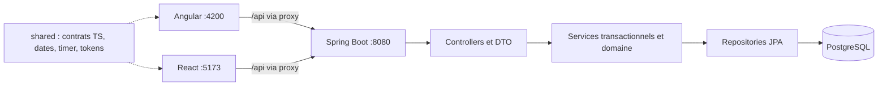

# FocusWithAkram — avancement technique

Relevé des sources du **1 novembre 2026**, branche `main`. Fonctionnel : [avancement fonctionnel](avancement-fonctionnel.md). Commandes : [exploitation](../technique/exploitation.md). Ce document traite du backend **et des deux frontends**.

## 1. Architecture d’ensemble



Le backend est un monolithe modulaire. Les deux interfaces partagent les contrats TypeScript et les tokens, mais gardent leurs composants et leur état. Aucun backend Node intermédiaire ni stockage métier séparé par frontend.

## 2. Technologies relevées

| Partie    | Manifest / sources                               | Versions déclarées                                                                              |
| --------- | ------------------------------------------------ | ----------------------------------------------------------------------------------------------- |
| Backend   | [pom.xml](../../backend/pom.xml)                    | Java 25, Spring Boot 4.1.2, springdoc 3.2.0, PostgreSQL, Flyway, JPA, Bean Validation           |
| Angular   | [package.json](../../frontend-angular/package.json) | Angular 22.2.x, TypeScript 6.0.2, RxJS 7.8, Tailwind 4.3, ECharts 6.1, Lucide                   |
| React     | [package.json](../../frontend-react/package.json)   | React 19.3.1, React Router 7.18, TanStack Query 5.105, Vite 8.3, TypeScript 6.0.2, Tailwind 4.3 |
| Tests web | Manifest React                                   | Playwright 1.64, axe 4.14, Vitest 5, ESLint 10                                                  |
| Identité  | [tokens](../../shared/design-tokens.css)            | Inter Variable locale ; thèmes via attribut `data-theme` et préférence système                  |

Ces valeurs décrivent les manifests ; les lockfiles déterminent les installations. Node 24.22.2 a été utilisé pour les validations ; les lanceurs acceptent les versions compatibles qu’ils contrôlent. Le Node système 22.12 rencontré pendant la recette est insuffisant pour Angular.

## 3. Backend — FWA-T001

### 3.1 Organisation

Racine : `backend/src/main/java/com/focusflow`. Depuis la refonte v2 (novembre 2026), chaque domaine est **à plat** : entités, enums, repositories, services, mappers et contrôleurs dans `com.focusflow.<domaine>`, seuls les DTO dans `<domaine>.dto`. Les archives forment le sous-domaine `task.archive`.

| Package | Responsabilité | Exemples |
| --- | --- | --- |
| `task` (+ `task.archive`) | Tâches, sous-tâches, étiquettes, cycles, Top 3, priorités, archives | Task, TaskService, PriorityService, ArchiveService |
| `project` | Projets et leurs indicateurs | Project, ProjectService, ProjectView |
| `pomodoro` | Sessions et historique | PomodoroSession, PomodoroService |
| `settings` | Préférences (singleton) | UserSettings, SettingsService |
| `dashboard`, `eisenhower`, `statistics`, `search` | Vues en lecture et agrégations | DashboardService, MatrixService, StatisticsService |
| `transfer` | Export CSV/JSON, sauvegarde versionnée, import | TransferService, BackupFile |
| `common`, `common.exception` | Pagination, PATCH partiels, erreurs HTTP | PageResponse, Patch, GlobalExceptionHandler |
| `config` | Horloge, CORS, PostgreSQL embarqué | ClockConfig, EmbeddedPostgresConfig |

Les règles d'organisation sont vérifiées par ArchUnit (`ModuleArchitectureTest`) ; voir l'[architecture backend](../technique/architecture-backend.md). Ne pas créer un repository ou une entité artificiels pour un domaine qui ne fait qu’agréger des données.

### 3.2 DTO et mises à jour partielles

49 types publics auparavant imbriqués dans des contrôleurs/services ont été extraits lors de la réorganisation. Les réponses métier ne sérialisent pas directement les entités. Les détails internes utiles, comme le snapshot d’une tâche ou une agrégation privée du mapper, peuvent rester encapsulés.

Les PATCH utilisent des DTO à setters explicitement typés. `PatchRequest` conserve les champs reçus, y compris ceux à `null`, puis les adapte au lecteur de patch métier. Les validations des règles de dates et de statut restent dans le domaine ou les services. Cette solution évite qu’un formulaire qui ne modifie que le thème remette à zéro les durées Pomodoro.

| Entrée                               | Intention                                                    |
| ------------------------------------ | ------------------------------------------------------------ |
| `{ "title": "A" }`                   | Modifier le titre sans toucher au projet ni aux dates        |
| `{ "projectId": null }`              | Retirer explicitement le projet                              |
| Corps JSON incompatible avec le type | Retour 400 avec code `BAD_REQUEST`                           |
| DTO de création invalide             | Retour 400 avec code `VALIDATION_ERROR` et erreurs de champs |

### 3.3 Transactions, horloges et persistance

- Les services délimitent les transactions ; `open-in-view=false` empêche de compter sur une session JPA ouverte pendant la sérialisation.
- Les invariants temporels des tâches sont dans `Task`. L’unicité de la session Pomodoro et sa machine à états sont contrôlées côté serveur.
- L’horloge est injectée ; les tests utilisent `MutableClock` pour les dates, pauses, expirations et changements d’heure.
- PostgreSQL conserve les instants ; Hibernate est configuré en UTC. Les bornes de jours/semaines dépendent de `SettingsService`.
- Flyway applique [le schéma initial](../../backend/src/main/resources/db/migration/V1__initial_schema.sql) ; Hibernate utilise `ddl-auto=validate`.
- Des champs de version et contraintes protègent les modifications concurrentes et les données incohérentes. Les agrégations groupées du mapper limitent les appels répétitifs sur les listes de tâches.

| Table                        | Rôle                                      |
| ---------------------------- | ----------------------------------------- |
| `project`, `task`            | Projets et état courant des tâches        |
| `tag`, `task_tag`, `subtask` | Étiquettes, associations et sous-tâches   |
| `task_execution`             | Historique des cycles d’exécution         |
| `pomodoro_session`           | Durées, état et rattachement des sessions |
| `daily_goal`                 | Top 3 d’un jour                           |
| `user_settings`              | Préférences de l’utilisateur unique       |

### 3.4 API et erreurs

Préfixe commun `/api/v1` ; documentation interactive `/swagger-ui.html`, document OpenAPI `/v3/api-docs`.

| Groupe                                       | Opérations principales                                                                                                             |
| -------------------------------------------- | ---------------------------------------------------------------------------------------------------------------------------------- |
| `/tasks`                                     | CRUD, priorités, statut, quadrant, ordre, démarrage, complétion, duplication, restauration, sous-tâches, chronologie et exécutions |
| `/tasks/archives`                            | Consultation paginée, facettes et détail                                                                                           |
| `/eisenhower/matrix`                         | Lecture de la matrice filtrée                                                                                                      |
| `/pomodoro`                                  | Session active, démarrage, pause/reprise, fin/interruption, historiques                                                            |
| `/projects`, `/tags`                         | Projets et liste des étiquettes                                                                                                    |
| `/dashboard`                                 | Résumé et Top 3                                                                                                                    |
| `/statistics/productivity`                   | Indicateurs et répartitions par période                                                                                            |
| `/settings`, `/search`                       | Préférences et recherche globale                                                                                                   |
| `/export/tasks`, `/export/backup`, `/import` | Transferts, sauvegarde et aperçu d’import                                                                                          |

`GlobalExceptionHandler` traduit les exceptions en `ProblemDetail`. Les familles sont 400, 404, 409, 422 et 500 ; les codes métier restent exploitables par les clients. Une erreur inattendue est journalisée côté serveur, avec un message générique côté API.

### 3.5 État de validation backend

Relevé du 1 novembre 2026 (refonte v2, lot 1) : **88 tests, 0 échec** (`mvn test`) : unitaires, intégration sur PostgreSQL embarqué jetable, contrat (`ApiContractIT`), architecture (`ControllerArchitectureTest`, `ModuleArchitectureTest` ArchUnit) et import/export (11 scénarios, dont la régression de l'import interrompu). Les preuves antérieures à la refonte sont dans [l’inventaire historique](../historique/2026-11-refonte-frontends/test-results/documentation-audit.json).

Les sorties Maven autrefois suivies ont été retirées du suivi Git ; `target/` est ignoré. Les fichiers de données ne doivent pas être placés dans un dossier que `mvn clean` peut supprimer, sauf base jetable de test assumée.

## 4. Frontend Angular — FWA-T002

Racine `frontend-angular/src`. Les seuls fichiers d’entrée standards au premier niveau sont `main.ts` et `index.html` ; les styles commencent dans `styles/index.css`.

```text
app/
  root/                       composant racine et template
  config/                     fournisseurs Angular
  routes/                     routes et chargement des pages
  core/                       API, services, intercepteurs, utilitaires
  features/<domaine>/
    pages/<page>/             .page.ts, .page.html, .page.css si nécessaire
    components/<composant>/   code et ressources du composant
    services/                 actions de la fonctionnalité
    constants/                constantes locales si nécessaires
  layout/                     shell, navigation, palette et aide
  shared/ui/                  composants regroupés par sous-dossier
```

Composants standalone, `OnPush`, signaux, application sans zone.js et HttpClient/RxJS. `SettingsStore` et `PomodoroEngine` coordonnent les préférences et la session ; `RefreshService` provoque les relectures après mutation, et `Loader` annule la requête précédente. La navigation est déclarée une seule fois (`config/navigation.ts`). Tests unitaires (Vitest) : 22 au 1 novembre 2026 (dates, minuteur, chargement, recherche différée, erreurs, navigation) ; lint ESLint autonome. Les pages sont chargées depuis les routes ; ECharts est configuré dans les composants partagés.

30 templates ont été externalisés. Le lint interdit les propriétés de métadonnées Angular `template` et `styles` inline. La matrice a des classes sémantiques et une feuille locale ; d’autres templates gardent encore des classes Tailwind. L’externalisation des templates ne signifie donc pas que cette conversion CSS est complète.

Le composant de réglages se trouve dans `features/pomodoro/components/pomodoro-settings/`. Il utilise le store partagé, vérifie les bornes, enregistre au changement et affiche les refus de notification. Les paramètres généraux ne portent plus les réglages du minuteur.

## 5. Frontend React — FWA-T003

Racine `frontend-react/src`. Entrée `main.tsx`, styles agrégés par `styles/index.css`.

```text
app/                         fournisseurs et navigation
core/                        HTTP, QueryClient, état, préférences, timer, utilitaires
features/<domaine>/
  pages/<page>/              page.tsx, page.view.tsx, use-page.ts
  components/<composant>/    vue, logique locale et CSS si spécifique
  context/, hooks/, types/   seulement si utiles à cette fonctionnalité
  constants/, styles/        constantes et styles de domaine
layout/<composant>/         shell et palette
shared/ui/, shared/charts/  un sous-dossier par composant
shared/styles/               adaptation de données aux variables CSS
tests/components/, tests/domain/
```

Les pages relient un hook de requêtes/actions à une vue JSX typée. Les hooks des pages ne contiennent pas de JSX. Les composants interactifs conservent leur état local quand il leur appartient, par exemple la référence d’un dialogue.

TanStack Query gère les lectures et invalidations ; le client a une fraîcheur de 10 secondes et relit au retour au premier plan. Le contexte applicatif synchronise la session et mémorise un état d’affichage du minuteur. Cela ne fournit pas de synchronisation hors ligne des données métier.

Le panneau Pomodoro a un brouillon contrôlé pour préserver les modifications non enregistrées lors des actualisations. Le bouton **Enregistrer le minuteur** n’envoie que les préférences Pomodoro. Les paramètres généraux envoient leurs propres champs. Les contextes contrôlent la présence de leur fournisseur.

## 6. Partage et frontières

| Chemin                     | Usage                                            |
| -------------------------- | ------------------------------------------------ |
| `shared/models.ts`         | DTO et enums TypeScript cohérents avec l’API     |
| `shared/time.ts`           | Dates, jours locaux et conversions d’horodatages |
| `shared/timer.ts`          | Calculs du temps restant                         |
| `shared/design-tokens.css` | Couleurs sémantiques, thèmes, ombres, rayons     |

Ne pas importer un composant Angular dans React ni réciproquement. Ne pas dupliquer une règle métier serveur dans les vues. La validation client améliore la saisie ; le backend reste l’autorité.

## 7. Décisions et dette technique

| Décision / limite                   | Motivation / suite                                                                                                              |
| ----------------------------------- | ------------------------------------------------------------------------------------------------------------------------------- |
| Un backend pour les deux variantes  | Comparaison sur les mêmes contrats et données ; pas de migration de données entre interfaces.                                   |
| Domaine puis couches                | Maintenir les fonctionnalités proches tout en explicitant DTO, entités et exceptions.                                           |
| DTO PATCH mutables à présence       | Préserver omission et `null` ; éviter un record nullable ambigu.                                                                |
| Services concrets                   | Pas d’interfaces sans besoin réel de substitution.                                                                              |
| Cache de session dans le navigateur | Continuité d’affichage ; ne pas le confondre avec un mode hors ligne.                                                           |
| CSS encore mixte en Angular         | Conversion des utilitaires à poursuivre ; styles globaux hérités à déplacer progressivement sans casser les composants enfants. |
| État applicatif React central       | Coordination de plusieurs responsabilités ; extraire progressivement avec tests de comportement.                                |
| Docker non validé                   | Contexte de build corrigé (racine du dépôt, `.dockerignore`) ; construction réelle et healthchecks restent à essayer.           |
| Avertissements de bibliothèques     | Dépréciations Spring/JDK et configuration de tests à examiner lors d’une mise à niveau dédiée.                                  |

## 8. Validation et points d’extension

Créer une fonctionnalité dans son domaine, définir les DTO, placer l’état et le rendu dans les dossiers prévus, tester ses règles puis documenter son exigence. Ajouter une table exige une nouvelle migration ; déplacer un package Java n’en exige pas.

Les tests backend emploient PostgreSQL temporaire et une horloge contrôlée. Les E2E utilisent le backend isolé `18080` ; les lancer sur la base personnelle est exclu de la procédure. Les builds et lints des deux variantes ont été validés pendant les lots frontend ; la présente révision ne les relance pas.
